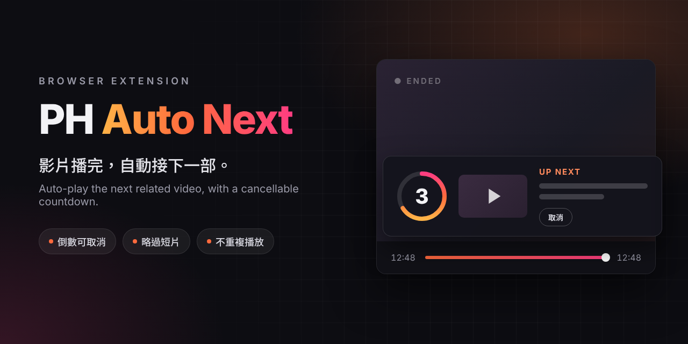

# PH Auto Next



影片播完後，自動跳到下一部相關影片。跳轉前會倒數，隨時可以取消。

Auto-play the next related video when the current one ends, with a cancellable countdown.

## 功能

- **倒數可取消**：播完先倒數幾秒，想留下來就按取消
- **略過短片**：自動跳過短於指定秒數的影片
- **不重複播放**：同一個分頁看過的影片不會再被選中，避免互跳迴圈
- 設定即時生效，不用重新整理頁面

## 安裝

1. 下載或 clone 這個 repo
2. 開啟 `chrome://extensions`（Edge 為 `edge://extensions`）
3. 打開右上角的「開發人員模式」
4. 點「載入未封裝項目」，選擇這個資料夾

## 設定

點工具列上的外掛圖示即可調整：

| 選項 | 預設值 |
| --- | --- |
| 啟用自動下一部 | 開 |
| 倒數秒數 | 3 |
| 略過短於幾秒的影片 | 30 |
| 不重複播放看過的 | 開 |

## 檔案結構

```
manifest.json   外掛設定 (Manifest V3)
content.js      偵測播放結束、挑選並跳到下一部
popup.html/js   設定介面
icons/          外掛圖示
assets/         README 與商店用圖片
```
